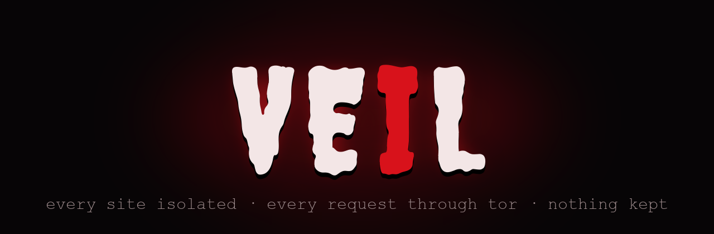
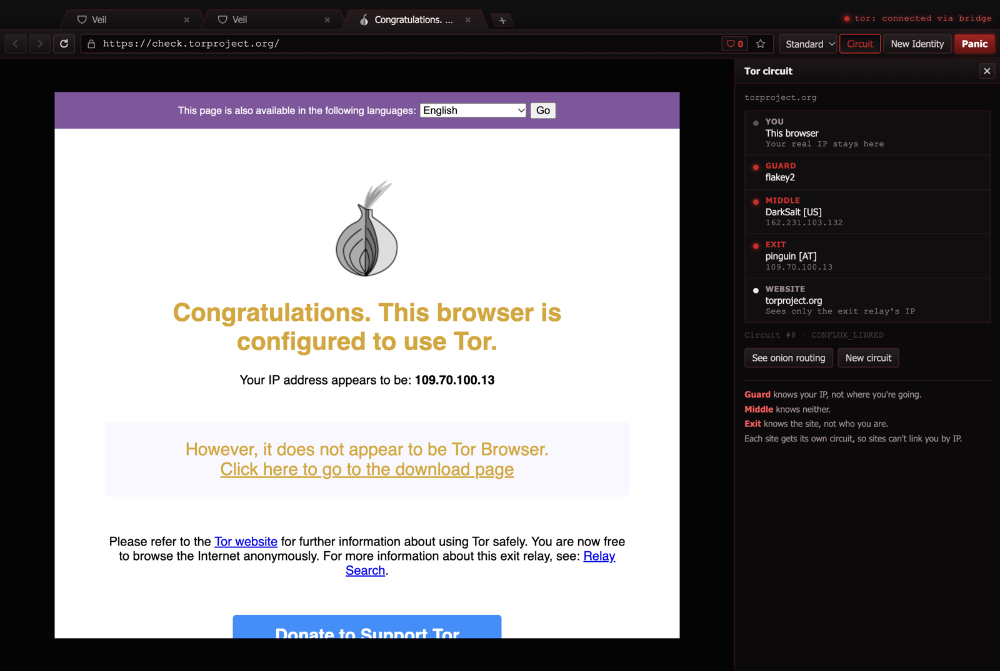
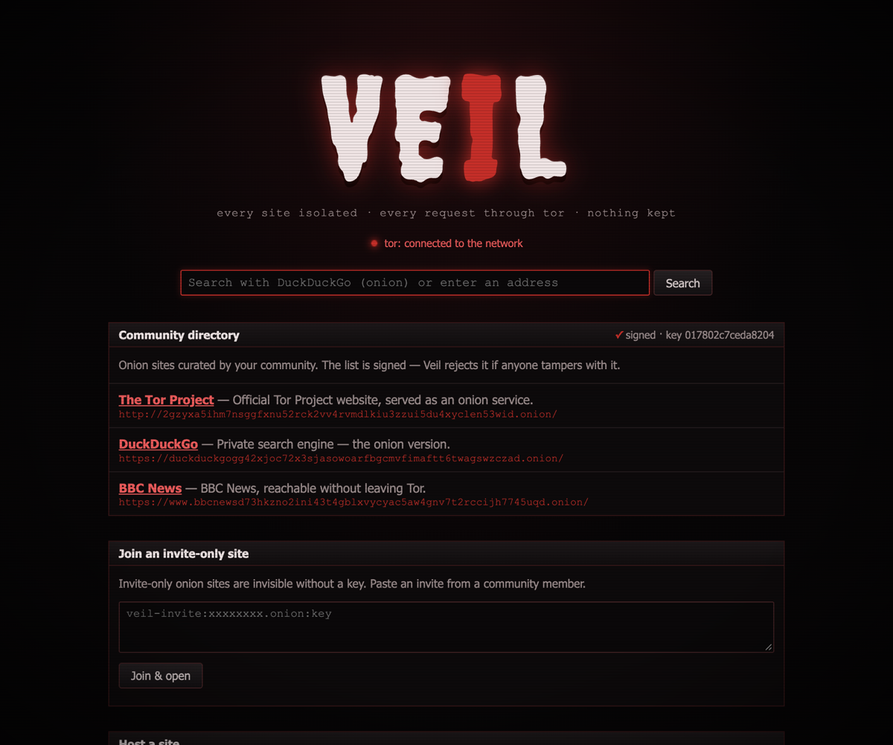
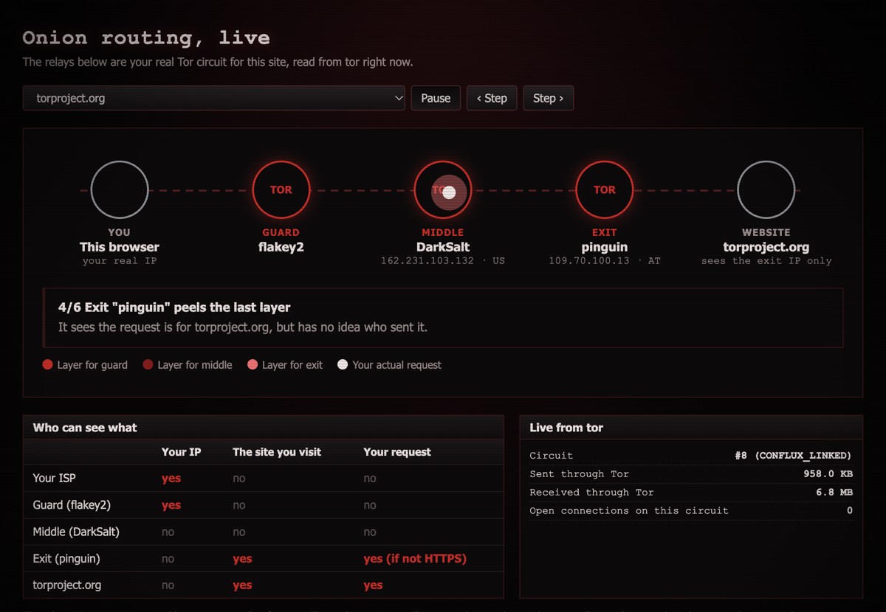
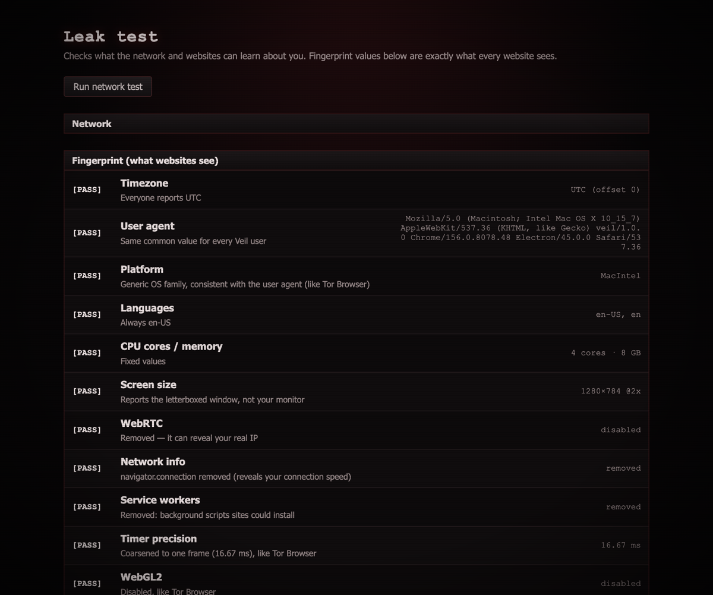

<p align="center">
  
</p>

<p align="center">
  <b>Veil Browser for Windows — Independent Windows Port</b><br>
  An anonymous browser inspired by Tor Browser, built by reverse engineering it.<br>
  Every request goes through the real Tor network, every site gets its own circuit, and nothing is kept.
</p>

<p align="center">
  
  
  
  
  
  
</p>

<p align="center">
  <a href="#download-for-windows">Download</a> ·
  <a href="#verify-what-you-downloaded">Verify SHA-256</a> ·
  <a href="#screenshots">Screenshots</a> ·
  <a href="#features">Features</a> ·
  <a href="#security-architecture">Security architecture</a> ·
  <a href="#community--feedback">Community</a> ·
  <a href="docs/ARCHITECTURE.md">Architecture</a>
</p>

<p align="center">
  
</p>

> ⚠️ **Disclaimer — read this first**
>
> Veil is an **educational project**. It has **not** been security-audited, and this Windows
> port has not been audited either. If your safety depends on staying anonymous (journalists,
> activists, whistleblowers), **use [Tor Browser](https://www.torproject.org/)**, not Veil.
>
> - Veil's fingerprint protection is weaker than Tor Browser's. It is built on Chromium and has
>   very few users, so it does not blend into a large crowd. **This port makes no claim of Tor
>   Browser fingerprint parity.**
> - No browser can protect you if you log in to personal accounts or share identifying details.
> - Tor protects your privacy; it does not make illegal activity legal. Follow the laws where
>   you live. The authors are not responsible for misuse.
> - Veil is not affiliated with or endorsed by The Tor Project, and the original Veil author has
>   not reviewed or endorsed this Windows port. "Tor" is a trademark of The Tor Project, Inc.
> - The Windows binaries are **not code-signed** and are **not scanned by VirusTotal** (see
>   [VirusTotal & antivirus status](#virustotal--antivirus-status)). Windows SmartScreen will
>   warn on the first run. Nothing here has been faked or hidden to make that sound better than
>   it is.

## Project origin & credits

Veil was **created by Nishant Tiwari** for macOS and Linux. This repository is an **independent
Windows port** of upstream `v1.0.0`, published under the same MIT licence, with the same original
copyright notice preserved.

| | |
|---|---|
| Original project | **Veil** by [Nishant Tiwari](https://github.com/nishant-Tiwari24) |
| Original repository | <https://github.com/nishant-Tiwari24/veil> (MIT) |
| Upstream release this port is based on | `v1.0.0` — its assets are macOS (`arm64`, `x64`) and Linux (`.AppImage`) only |
| Windows port | developed and maintained by the GitHub account that owns this repository; its commits are the Windows work in [the commit history](../../commits/main) |
| Windows edition repository | this repository — see [Releases](../../releases) for the built installers |

The upstream author did **not** implement the Windows support and is **not** responsible for this
port. The Windows port does not change the licence, does not remove upstream copyright notices,
and does not claim ownership of upstream code. Full breakdown:
[docs/UPSTREAM.md](docs/UPSTREAM.md) and [docs/CREDITS.md](docs/CREDITS.md).

## Download for Windows

Get the latest Windows build from **[Releases](../../releases)**. Each release ships the two
files below plus `SHA256SUMS.txt` and `SBOM.json`.

| File | What it is | Notes |
|---|---|---|
| `Veil-<version>-Windows-x64-Setup.exe` | NSIS installer, per-user | Installs to `%LOCALAPPDATA%\Programs\Veil`, adds a Start Menu entry, no admin rights needed |
| `Veil-<version>-Windows-x64-Portable.exe` | single self-contained executable | No installation; extracts to a temp folder on each run and cleans up afterwards |

Both are **x64 only** — there is no Windows ARM64 build. Both are **unsigned**: Windows
SmartScreen and some antivirus products will flag them, which is expected for an unsigned
Electron binary and is disclosed rather than worked around. The Tor daemon and the pluggable
transports are bundled inside the installer, downloaded from `dist.torproject.org` and verified
against the Tor Project signing key at build time — see
[docs/WINDOWS_BUILD.md](docs/WINDOWS_BUILD.md).

## Installing on Windows

1. Download the Setup or Portable build from [Releases](../../releases).
2. **Verify the hash** (see the next section) before running anything.
3. Setup: run the `.exe`. If SmartScreen appears, choose **More info → Run anyway** — that
   prompt exists because the build is unsigned, and only you can decide to proceed.
   The installer is per-user: it never requests elevation and writes only under your profile.
4. Portable: run the `.exe` directly. Keep it in a folder whose path you can read back —
   the launcher extracts to `%TEMP%` while it runs.
5. On first launch Veil starts its own `tor.exe`, bootstraps through the Tor network, and
   refuses to load any page until Tor is ready. That wait is the kill switch working.

Troubleshooting, including "the installer was quarantined", "Tor never bootstraps" and
bridge setup on a network that blocks Tor: [docs/WINDOWS_SUPPORT.md](docs/WINDOWS_SUPPORT.md).

## Verify what you downloaded

Every release attaches `SHA256SUMS.txt`, generated from the bytes that were actually uploaded.
Check the file you downloaded before running it:

```powershell
# PowerShell — compare the digest of your download with SHA256SUMS.txt
Get-FileHash .\Veil-1.0.0-Windows-x64-Setup.exe -Algorithm SHA256

# or check the whole sums file at once
Get-Content .\SHA256SUMS.txt
Get-FileHash .\*.exe -Algorithm SHA256 | Format-Table Name, Hash -AutoSize
```

```bash
# Git Bash / any sh
sha256sum -c SHA256SUMS.txt
```

A mismatch means the download is corrupt or has been substituted — do not run it, and report it
privately as described in [SECURITY.md](SECURITY.md).

The SBOM (`SBOM.json`, CycloneDX 1.5) lists every component that went into the build, including
the exact SHA-256 of `tor.exe`, `lyrebird.exe`, `conjure-client.exe`, `geoip` and `geoip6`, and
the signature verification result for the archive they came from. Those digests are reproduced
from `bin/win32-x64/manifest.json`, which `npm run tor:fetch` writes after verifying the Tor
Project detached signature against the pinned fingerprint
`EF6E286DDA85EA2A4BA7DE684E2C6E8793298290`.

## VirusTotal & antivirus status

**Not measured.** No VirusTotal scan report is published here because none has been run on
these exact binaries yet. A scan of a build that no longer exists would be worthless, and a
badge would be a fake claim, so this section states the current state instead:

| check | status |
|---|---|
| `Veil-1.0.0-Windows-x64-Setup.exe` scanned on VirusTotal | **not run yet** |
| `Veil-1.0.0-Windows-x64-Portable.exe` scanned on VirusTotal | **not run yet** |
| code-signing certificate | **none** — not faked, not self-signed-and-labelled-as-authentic |
| SmartScreen reputation | **not established** |

Uploading a build to VirusTotal publishes it to a third party and is only done deliberately,
against the exact bytes that are attached to a release. The procedure, what evidence will be
recorded (scan date, file hash, detection ratio, permalink) and what will never be claimed is in
[docs/security/VIRUSTOTAL.md](docs/security/VIRUSTOTAL.md). This README is only updated when the
evidence matches the released hash.

Expect antivirus questions regardless: an unsigned, self-extracting Electron executable that
spawns a Tor daemon is exactly the shape many engines watch for. What to do about a false
positive is in [docs/WINDOWS_SUPPORT.md](docs/WINDOWS_SUPPORT.md). Do not disable your antivirus
to make Veil run; investigate the detection and report it.

## Screenshots

<table>
  <tr>
    <td><br><sub><b>Home:</b> signed community directory, invite-only sites, one-click onion hosting</sub></td>
    <td><br><sub><b>See onion routing:</b> your real circuit, one layer peeled per relay</sub></td>
  </tr>
  <tr>
    <td><br><sub><b>.onion sites:</b> BBC News over a Tor onion service</sub></td>
    <td><br><sub><b>Leak test:</b> what a website can learn about you</sub></td>
  </tr>
</table>

Screenshots are from the upstream project (macOS/Linux); the Windows UI is the same layout with
`Ctrl` in place of `⌘`.

## Features

Everything upstream does still works — this is a port, not a rewrite. On Windows the shortcuts
use `Ctrl` (`CmdOrCtrl` in the code), and full screen is `F11`.

**Everyday browsing**
- Tabs: new `Ctrl+T`, close `Ctrl+W`, drag to reorder, right-click menu (duplicate, close
  others), reopen closed tab `Ctrl+Shift+T`, `Ctrl+1–9`, `Ctrl+Tab` / `Ctrl+Shift+Tab`
- Address bar `Ctrl+L` that searches privately (DuckDuckGo's onion) and shows your search terms,
  with suggestions from this session
- Back / forward / reload / stop, Home `Ctrl+Shift+H`, favicons (fetched through Tor),
  zoom `Ctrl+=` / `Ctrl+-` / `Ctrl+0`, print `Ctrl+P`, full-screen video, `F11`
- Find in page `Ctrl+F`, `Ctrl+G` / `Ctrl+Shift+G`
- Right-click menu: open link in new tab, copy link, search selection, copy/paste, inspect
- Bookmarks `Ctrl+D` (saved only if you choose to; Panic deletes them), `Alt+Ctrl+B` for the hub
- History `Ctrl+Y`, kept in memory for this session only
- Downloads through Tor, with a warning before saving
- Works with normal websites **and** .onion sites; shows ".onion available" when a site has an
  onion version

**Anonymity**
- All traffic through Tor, with a kill switch (no Tor = nothing loads, including `file:`,
  `javascript:` and anything else that is not http/https)
- Per-site Tor circuits and per-site storage partitions: sites cannot link you
- No local DNS, no WebRTC, no QUIC: no leaks around Tor
- Amnesic: nothing about your browsing written to disk; `Panic` `Ctrl+Shift+X` also clears the
  clipboard and the bookmark file
- Fingerprint resistance: generic per-OS user agent (`Windows NT 10.0; Win64; x64` with no
  Windows build number), UTC timezone, letterboxing, 16.67 ms timer clamp, canvas noise, WebGL
  masking, no WebGL2 / network information / service workers
- Outbound request headers are filtered: the device and network client hints
  (`sec-ch-ua-arch`, `-bitness`, `-model`, `-platform-version`, `sec-ch-dpr`, `sec-ch-viewport-*`,
  `rtt`, `downlink`, `ect`, `save-data`, …) are removed before they leave, `sec-ch-ua-platform`
  is normalised to `"Windows"`, and `Accept-CH` / `Critical-CH` are stripped from responses so a
  site cannot ask for them
- HTTPS-Only mode, onion addresses never leak via `Referer`, onion-specific error messages
- Security levels: Standard / Safer / Safest (JavaScript off)
- Live circuit map, **New Identity** `Ctrl+Shift+U` (rotates to a fresh exit address),
  **New Circuit for This Site** `Ctrl+Shift+L`, **Panic** `Ctrl+Shift+X`
- **See onion routing** `Ctrl+Shift+O`: an animated view of your real circuit, with a packet
  losing one encryption layer per relay, who-sees-what, and live traffic from tor
- **Ad & tracker blocking** (EasyList + EasyPrivacy): the same built-in list for every user so it
  cannot fingerprint you; the shield badge shows the count, click to allow ads on a site for this
  session
- Built-in leak test
- Community Hub: signed directory, invite-only sites, one-click onion hosting

**Windows-specific (this port)**
- Bundled, signature-verified Windows `tor.exe` 0.4.9.15 plus `lyrebird.exe` and
  `conjure-client.exe` — bridges work on Windows without a separate Tor Browser install
- obfs4, Snowflake and meek_azure bridges, configured from the Connection panel
- Platform behaviour (paths, process ownership, termination, stale-profile cleanup, window chrome)
  is isolated in `src/main/platform.js`; no `if (windows)` checks scattered through the app
- Bounded, retrying state cleanup: `%TEMP%\veil-tor-<bootstrap-id>` directories are removed when
  their owner is gone, and never while another Veil is still using them
- Per-user NSIS installer and single-file portable build, both x64

## Security architecture

The design is documented as a set of architecture decision records —
[docs/ARCHITECTURE.md](docs/ARCHITECTURE.md) and [docs/adr](docs/adr) — and the Windows-specific
measurements are in [docs/WINDOWS_REVERSE_ENGINEERING.md](docs/WINDOWS_REVERSE_ENGINEERING.md).

Short version of how a page request travels:

```
renderer (sandboxed, no nodeIntegration, contextIsolation on)
   ↓  IPC over a narrow, validated channel; privileged UI in separate windows
main process
   ↓  per-site credentials → per-site SOCKS5 relay (src/main/relay.js)
   ↓  kill switch: nothing is forwarded until tor reports bootstrap 100%
local tor (127.0.0.1 SOCKS + control port, cookie auth)
   ↓  circuit built for this site only
3 Tor relays → exit → destination
```

Deliberate exceptions, because "just enable every hardening flag" is not true on Electron:
- `webSecurity` stays on; `contextIsolation` is on and `nodeIntegration` is off for web content.
- The fingerprint protection relies on a preload for internal pages and on
  `session.setPermissionRequestHandler` refusing everything by default — that behaviour is
  load-bearing, not decoration, and is exercised by the self-test rather than assumed.
- The ad-block engine runs in the main process so the block list is identical for every user.
- `webRequest.onBeforeSendHeaders` is the only place outbound headers are rewritten; the
  `X-Client-Data` header Chromium adds on Google-owned domains is dropped there too.

## Verification status (measured on Windows)

These numbers are the results of actually running the commands on Windows 11 x64
(10.0.26200), Node v24, tor 0.4.9.15. Full test map: [docs/WINDOWS_TESTING.md](docs/WINDOWS_TESTING.md).

| command | result |
|---|---|
| `npm run check` | exit 0 — every `.js` parses, internal pages compile, community directory signature verifies, vendored assets present |
| `npm test` | 67 pass / 0 fail / **0 skipped**, ~35 s |
| `npm run selftest` | **43 checks: 42 PASS, 1 KNOWN, 0 FAIL** |
| `node scripts/check-windows-artifacts.js veil-dist` | 28 packaging checks pass — PE architecture of every executable, no Unix binaries inside a Windows build, tor provenance and signature record, `latest.yml` sha512 cross-checked against the installer bytes, `SHA256SUMS.txt` re-hashed from disk |
| `npm audit --audit-level=critical` | 0 high, 0 critical |

The self-test's three outcomes are **PASS / FAIL / KNOWN**, and KNOWN is never counted as a pass.
It means "this check needs a third party that did not answer", and the reason is printed with it —
the one KNOWN in the run above is the check that reads back the headers through
[httpbin.org](https://httpbin.org), which did not reply; the same headers are measured directly on
the wire by two other checks that did pass. Skips are reported, not hidden.

What is **not** verified: the Tor Browser parity claim, a formal security audit, code signing,
and VirusTotal results (see above). See [Known limitations](#known-limitations).

## Run from source on Windows

Requirements: Windows 10/11 x64, [Node.js](https://nodejs.org/) 22 or newer, and a `gpg` binary
(the one shipped with Git for Windows at `C:\Program Files\Git\usr\bin\gpg.exe` is used
automatically if it is the only one on `PATH`).

Clone this repository — the URL is on the **Code** button of this page — then, from PowerShell
inside the checked-out folder:

```powershell
npm install
npm run tor:fetch      # verifies the Tor Project signature, then unpacks bin\win32-x64
npm start
```

```powershell
npm run test:unit      # no tor, no network
npm test               # everything, tor required
npm run selftest       # the 43 anonymity checks against the live Tor network
npm run dist           # builds Setup + Portable into veil-dist\
node scripts/check-windows-artifacts.js veil-dist
npm run release:evidence   # writes SHA256SUMS.txt and SBOM.json from the built bytes
```

To run against a tor you already have, set `VEIL_TOR_PATH`. Building notes, including what
`electron-builder` does and does not verify: [docs/WINDOWS_BUILD.md](docs/WINDOWS_BUILD.md).

## Do I still need a VPN?

Not for browsing **inside Veil**: every page already goes through 3 Tor relays, which hides your
IP from websites and hides the sites you visit from your ISP. But Veil only protects Veil. Other
apps on your Windows machine are not covered — and unlike a VPN, Tor does not hide the fact that
you are connecting to Tor from your ISP.

Some websites block or challenge Tor users (CAPTCHAs, banking, some Google services). That is the
site refusing Tor, not a Veil bug. Use `Ctrl+Shift+L` (new circuit) to try a different exit relay.

If your country or network blocks Tor itself, connect through a bridge (obfs4, Snowflake or meek)
from the Connection section on the home page.

## Troubleshooting

The common Windows cases are written up in [docs/WINDOWS_SUPPORT.md](docs/WINDOWS_SUPPORT.md):
first-run SmartScreen prompt, antivirus quarantine, Tor stuck at bootstrap, `tor.exe` left
running after a crash, `%TEMP%\veil-tor-*` directories, portable build slow to open, bridges not
connecting, and how to collect a useful (and non-revealing) log for a bug report.

## Known limitations

Stated plainly, because hiding them would be worse than living with them:

- **Not security-audited.** No professional audit of Veil or of this port has been performed.
- **Not code-signed.** No Windows code-signing certificate is available for this project, so the
  executables are unsigned, SmartScreen has no reputation for them, and no signature is faked.
- **Not VirusTotal-scanned** at the time of writing — see the status section above.
- **No Tor Browser parity.** Chromium-based, far smaller user base, and several hardening
  mechanisms Tor Browser has (a curated Firefox fork, Tor Browser's own fingerprint settings,
  Project Null/Amnesia-style research) are absent. The claim here is only "measured not to leak
  the headers we checked".
- **x64 only** — no Windows ARM64 build.
- **No bundled fonts** beyond the upstream Creepster title font, so Windows' default font
  metrics are part of the fingerprint. Font-bundle parity is open work.
- **One Veil instance per Tor process.** Running the Setup and Portable builds at the same time
  is supported, but they keep separate state.
- **New Identity and Panic are measured, not assumed** — they were verified to rotate the exit
  address and to clear tabs, history, clipboard and bookmarks. Other upstream guarantees were not
  re-measured on Windows specifically.
- The in-app self-test's live checks need a working path to the Tor network; on a network that
  blocks Tor, use a bridge first.

## What Veil stores about you

Nothing about your browsing. History, cookies, cache and localStorage live in per-site partitions
in memory and in a temp directory that is deleted on shutdown; bookmarks exist only if you add
them, and Panic deletes that file too. There is **no telemetry, no analytics, no crash reporter
and no update pinger** in this build. Veil does not send anything about you to this repository,
to GitHub, or to the developers — the only outbound traffic is what you ask for, through Tor.
The issue templates ask for a Veil version, a Windows version and an architecture because those
are needed to reproduce a bug; do not attach history files, `.onion` addresses, cookies or
packet captures to a report.

## Community & feedback

### Give your review
If you use Veil on Windows, tell us what happened — in [an Issue](../../issues) or, once
[Discussions](../../discussions) is enabled on this repository, there. Say what you expected, what
happened, and which build you used. Reviews are user opinions: this project will never invent
testimonials, ratings, download counts or "community praise", and nothing in this README is a
review.

### Report a bug
Use **[→ Report a bug](../../issues/new?template=bug_report.yml)**. The form asks for the Veil
version, which build (Setup, Portable or from source), Windows version and architecture, the steps
you took, what you expected, what actually happened, how often it repeats, and where Tor was in
its bootstrap when it happened. That is enough to reproduce most reports without you having to
guess what we need.

**Do not report security vulnerabilities in a public Issue** — use the private channel described in
[SECURITY.md](SECURITY.md). The bug form refuses that category on purpose.

### Request a feature
Use **[→ Request a feature](../../issues/new?template=feature_request.yml)**: the problem you have,
the solution you suggest, who benefits, and what alternatives you considered. Feature requests that
would weaken anonymity (for example a "remember my sites" option or a per-site user agent) get
extra scrutiny, because that is the trade this project exists to make.

### Ask questions & get help
Start with [docs/WINDOWS_SUPPORT.md](docs/WINDOWS_SUPPORT.md) and the
[documentation index](#documentation). Then search [existing Issues](../../issues) — someone may
have hit the same thing. Ask as an Issue with the `question` label, or in
[Discussions](../../discussions) if this repository has them enabled. There is no Discord, Telegram,
Matrix, Reddit or email list for Veil, so none is linked here; if that changes it will be a real
link, not a decorative button.

### Contributing code
Read [CONTRIBUTING.md](CONTRIBUTING.md): the setup commands, the four test layers, the rule that
platform differences live in `src/main/platform.js`, and the honesty rule about test outcomes.
Small, reversible changes with measured numbers beat big claims.

## Reporting a security vulnerability

**[SECURITY.md](SECURITY.md)** — GitHub private vulnerability reporting
(**Security → Report a vulnerability** on this repository). Not a public Issue, not a Discussion.
There is no SLA and no bounty, and the project's standing caveat applies: Veil is not audited.

## Licence & third-party notices

Veil is **[MIT](LICENSE)** — the same licence as upstream, unchanged, with the original copyright
notice preserved.

The Windows builds also contain other people's work, and their licences are theirs:

| component | licence | where it comes from |
|---|---|---|
| `tor.exe`, `geoip`, `geoip6` | GPL-3.0-or-later | Tor Project expert bundle 16.0, signature-verified |
| `lyrebird.exe` | BSD-3-Clause | Tor Project lyrebird |
| `conjure-client.exe` | BSD-3-Clause | refraction.networking |
| libevent, OpenSSL, zlib (linked into tor) | BSD-3-Clause / OpenSSL dual / Zlib | as shipped in the Tor bundle |
| Electron 45 (Chromium, V8, Node) | MIT (+ Chromium/Bundled libs) | electron.org |
| `@ghostery/adblocker`, `tldts` and their transitive tree | see notices | npm, pinned by `package-lock.json` |
| EasyList / EasyPrivacy (compiled into `assets/adblock.engine`) | custom (share-alike) | easylist.cc |
| Creepster font | SIL OFL 1.1 | [assets/fonts/Creepster-OFL.txt](assets/fonts/Creepster-OFL.txt) |

Full list with per-package versions and licence ids:
[docs/THIRD_PARTY_NOTICES.md](docs/THIRD_PARTY_NOTICES.md) and the machine-readable `SBOM.json`
attached to each release.

"Tor" is a trademark of The Tor Project, Inc.; Electron and Chromium are trademarks of their
respective owners. Veil is not affiliated with or endorsed by any of them.

## Documentation

| document | what it covers |
|---|---|
| [SECURITY.md](SECURITY.md) | private vulnerability reporting, what counts as a vulnerability |
| [CONTRIBUTING.md](CONTRIBUTING.md) | setup, test layers, conventions, packaging |
| [CHANGELOG.md](CHANGELOG.md) | what this port added and fixed, and what is still open |
| [docs/UPSTREAM.md](docs/UPSTREAM.md) | upstream identity, licence, sync policy, attribution |
| [docs/CREDITS.md](docs/CREDITS.md) | who built what |
| [docs/THIRD_PARTY_NOTICES.md](docs/THIRD_PARTY_NOTICES.md) | every bundled component and its licence |
| [docs/WINDOWS_SUPPORT.md](docs/WINDOWS_SUPPORT.md) | installation, first run, troubleshooting |
| [docs/WINDOWS_BUILD.md](docs/WINDOWS_BUILD.md) | building, fetching and verifying tor, releasing |
| [docs/WINDOWS_TESTING.md](docs/WINDOWS_TESTING.md) | the four test layers and their measured results |
| [docs/WINDOWS_REVERSE_ENGINEERING.md](docs/WINDOWS_REVERSE_ENGINEERING.md) | how the Windows behaviour was measured |
| [docs/security/VIRUSTOTAL.md](docs/security/VIRUSTOTAL.md) | malware-scan policy and current (empty) evidence |
| [docs/ARCHITECTURE.md](docs/ARCHITECTURE.md) | process model, IPC, storage, tor control |
| [docs/adr](docs/adr) | the eleven design decisions behind Veil |
| [docs/REVERSE_ENGINEERING.md](docs/REVERSE_ENGINEERING.md) | how upstream reverse engineered Tor Browser |
| [docs/PLAN.md](docs/PLAN.md) · [docs/TODO.md](docs/TODO.md) | upstream roadmap and open work |

## Run the community directory (maintainers)

```bash
npm run community:keygen   # once, creates the signing key (keep community.key secret)
# edit community/directory.json
npm run community:sign     # re-sign after every change
```

```bash
npm run adblock:update     # rebuilds assets/adblock.engine; do this before each release
```
